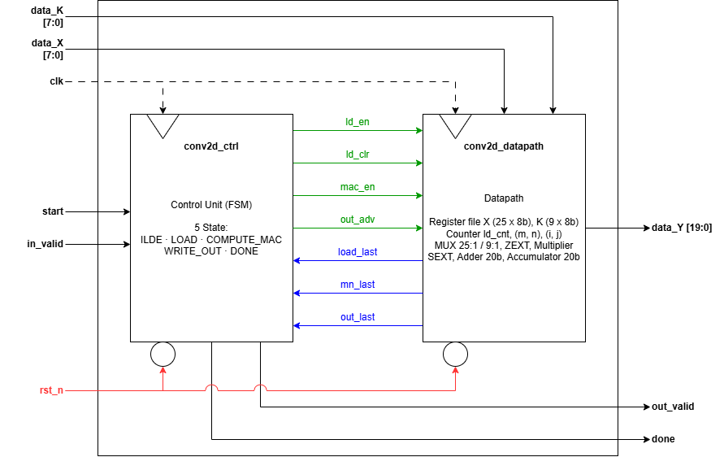
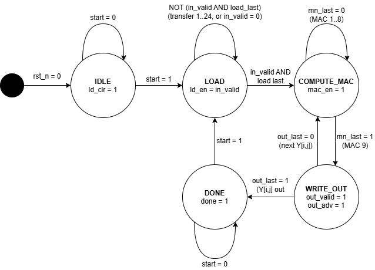
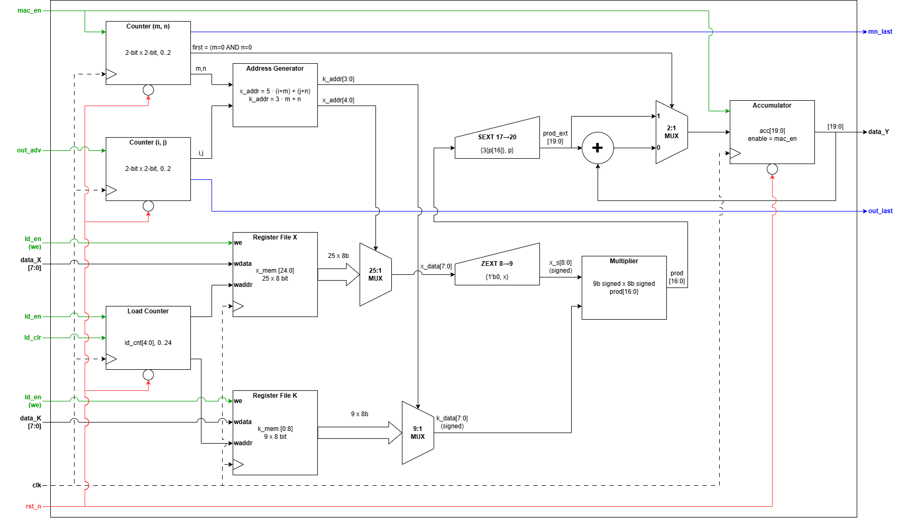

# Sequential 2D Convolution Engine

RTL design of a **Sequential Convolution Engine** built as an **FSMD** (Finite State Machine with Datapath) in Verilog. The engine computes a 2D convolution of a 5×5 input with a 3×3 kernel using **a single shared MAC unit**, trading latency for arithmetic area.

## Highlights

- Control/datapath separation (FSMD) with a 5-state FSM; loop bounds live in datapath counters, so the FSM stays small.
- One multiplier and one adder, shared across all 81 MAC operations.
- No accumulator-clear cycle: the first product of each output is loaded directly into the accumulator.
- Address multiplications (×5, ×3) implemented as shift-and-add, keeping the single multiplier reserved for MAC.
- Self-checking testbench with protocol monitors, 26 test scenarios, and an independent Python golden model.
- Deterministic latency of **115 cycles** without stall, confirmed in simulation.

---

## Specification

2D convolution with stride 1 and no padding:

```
Y[i,j] = Σ(m=0..2) Σ(n=0..2) X[i+m, j+n] · K[m,n]      i, j = 0..2
```

| Item | Specification |
|---|---|
| Input `X` | 5×5, unsigned 8-bit, streamed in row-major order |
| Kernel `K` | 3×3, signed 8-bit (two's complement) |
| Output `Y` | 3×3, signed 20-bit |
| Arithmetic | 1 multiplier + 1 adder (resource sharing) |
| FSM | 5 states: `IDLE`, `LOAD`, `COMPUTE_MAC`, `WRITE_OUT`, `DONE` |
| Reset | Asynchronous, active-low (`rst_n`) |
| Latency | **115 clock cycles** without stall (25 LOAD + 9 × (9 MAC + 1 WRITE)) |

## Architecture

The design is split into three modules with a clear boundary between control and data:

| Module | Role |
|---|---|
| `conv2d_engine` | Top-level module; only connects the control unit and the datapath |
| `conv2d_ctrl` | Control unit (FSM) |
| `conv2d_datapath` | X/K register files, index counters, address generator, multiplier, accumulator |



### FSM



| State | Function |
|---|---|
| `IDLE` | Waits for a `start` pulse; the load counter is cleared |
| `LOAD` | Stores 25 transfers of `data_X` into `X[0..24]` and `data_K` into `K[0..8]` (first 9 transfers), only when `in_valid = 1` |
| `COMPUTE_MAC` | One multiply-accumulate per clock; 9 clocks per output point `Y[i,j]` |
| `WRITE_OUT` | `out_valid` is HIGH for 1 clock while `data_Y` holds `Y[i,j]` |
| `DONE` | `done = 1` after all 9 outputs; a new `start` returns to `LOAD` |

### Datapath



- **Register files** `x_mem` (25×8-bit) and `k_mem` (9×8-bit). They have no reset since they are always fully written during `LOAD` before being read.
- **Address generator:** `x_addr = 5·(i+m) + (j+n)` and `k_addr = 3·m + n`, implemented with shift-and-add so the main multiplier is not used for addressing.
- **Zero-extender** (8→9 bit) on the unsigned pixel, so pixels ≥ 128 are not misread as negative by the signed multiplier.
- **Multiplier:** 9-bit signed × 8-bit signed → 17-bit product, sign-extended to 20 bits.
- **Accumulator:** 20-bit. On the first MAC of each output point (`m = n = 0`) the product is loaded directly, so no separate clear cycle is needed. `Y[i,j]` stays stable on `data_Y` throughout `WRITE_OUT` and `DONE`.

### FSM ↔ Datapath Interface

| Signal | Direction | Description |
|---|---|---|
| `ld_en` | FSM → DP | Write data into the register files (state `LOAD` and `in_valid = 1`) |
| `ld_clr` | FSM → DP | Clear the load counter (state `IDLE`) |
| `mac_en` | FSM → DP | Update the accumulator and advance the `(m,n)` index |
| `out_adv` | FSM → DP | Advance the output index `(i,j)` |
| `load_last` | DP → FSM | Last transfer (`ld_cnt = 24`) |
| `mn_last` | DP → FSM | 9th MAC (`(m,n) = (2,2)`) |
| `out_last` | DP → FSM | Last output point (`(i,j) = (2,2)`) |

### Top-Level Ports (`conv2d_engine`)

| Port | Direction | Width | Description |
|---|---|---|---|
| `clk` | Input | 1 | Main clock |
| `rst_n` | Input | 1 | Asynchronous reset, active-low |
| `start` | Input | 1 | 1-clock pulse to begin |
| `in_valid` | Input | 1 | `data_X` and `data_K` are valid on this clock |
| `data_X` | Input | 8 | X pixel (unsigned), row-major order |
| `data_K` | Input | 8 | K weight (signed), first 9 transfers |
| `out_valid` | Output | 1 | 1-clock pulse when `data_Y` is valid |
| `data_Y` | Output | 20 | Result `Y[i,j]` (signed) |
| `done` | Output | 1 | HIGH after all 9 `Y` values are produced |

## Repository Structure

```
.
├── src/
│   ├── conv2d_engine.v          # Full design (top + ctrl + datapath) in one file
│   └── hierarchical/            # Same design split into one file per module
│       ├── conv2d_engine_top.v
│       ├── conv2d_ctrl.v
│       └── conv2d_datapath.v
├── tb/
│   └── tb_conv2d.v              # Self-checking testbench
├── scripts/
│   └── golden_model.py          # Python golden model and simulation-log checker
├── sim/                         # Simulation output (sim.log, conv2d.vcd, conv2d.vvp)
├── docs/                        # FSM, datapath, and system block diagrams
├── Makefile
└── README.md
```

The files in `src/hierarchical/` contain modules identical to those in `conv2d_engine.v`, split per file to ease module-by-module simulation. The `make` targets below use the single-file version.

## Getting Started

### Prerequisites

- [Icarus Verilog](https://github.com/steveicarus/iverilog) (`iverilog`, `vvp`)
- Python 3
- GTKWave (optional, for viewing waveforms)
- Yosys (optional, for a synthesis check)

### Make Targets

```bash
make          # compile, simulate, then check results against the golden model
make sim      # compile and simulate; log is saved to sim/sim.log
make check    # compare the simulation log with the Python golden model
make golden   # print the golden model results
make wave     # open sim/conv2d.vcd in GTKWave
make synth    # synthesis check with Yosys
make clean    # remove simulation artifacts
```

Manual compile without Make:

```bash
iverilog -g2005 -Wall -o sim/conv2d.vvp src/conv2d_engine.v tb/tb_conv2d.v
vvp sim/conv2d.vvp | tee sim/sim.log
```

A successful run ends with:

```
=== ALL TESTS PASSED (26 tests) ===
```

## Verification

The testbench `tb/tb_conv2d.v` is **self-checking**: every `Y[i,j]` observed while `out_valid = 1` is compared against a reference value computed inside the testbench (nested-loop integer arithmetic that follows the convolution equation directly). A per-clock monitor also checks that:

1. `data_Y` matches the expected value whenever `out_valid` is high,
2. `out_valid` is a single-cycle pulse,
3. `out_valid` and `done` are never active at the same time,
4. `done` does not assert before all 9 outputs have been produced.

A watchdog timer (5 ms of simulated time) prevents the simulation from hanging if `done` never arrives.

### Test Scenarios (26 tests)

| Test | Scenario | Purpose |
|---|---|---|
| 1 | Example matrix from the assignment (simple vertical Sobel-style kernel) | Basic functional verification |
| 2 | All `X = 255`, all `K = -128` | Extreme negative case; checks for accumulator overflow |
| 3 | All `X = 255`, all `K = +127` | Extreme positive case; checks for accumulator overflow |
| 4 | All `X = 0`, random `K` | `Y = 0` regardless of kernel values |
| 5 | Asynchronous reset in the middle of `LOAD` (after 10 of 25 transfers), then rerun of Test 1 | Reset is truly asynchronous and the FSM recovers |
| 6–26 | 21 random cases; even-numbered tests insert `in_valid` stalls, odd-numbered tests do not | Randomized coverage and stall tolerance |

Test 5 uses a dedicated code path outside `run_test` to inject the reset, so it does not print the standard `INFO ... completed` latency line.

### Golden Model

`scripts/golden_model.py` computes the 2D convolution in plain Python arithmetic, independent of any HDL width or overflow behavior. Its `--check` mode reads the `RESULT test=1 i=.. j=.. Y=..` lines from `sim/sim.log` and compares them to `conv2d(X_EXAMPLE, K_EXAMPLE)`.

```bash
python3 scripts/golden_model.py                        # results for the example case
python3 scripts/golden_model.py --check sim/sim.log    # check the simulation log
python3 scripts/golden_model.py --random 3 --seed 1    # 3 random cases
```

## Results

### Test 1: Reference Case

`X`:

```
1 2 0 1 3
2 1 3 2 0
0 1 2 1 1
1 3 0 2 2
2 0 1 0 1
```

`K`:

```
 1  0 -1
 1  0 -1
 1  0 -1
```

`Y` (RTL simulation, 100% match with the golden model):

```
-2  0  1
-2  0  2
 0  1 -1
```

### Latency

| Condition | Cycles |
|---|---|
| No stall (Tests 1–4 and all odd-numbered tests) | **115**, exactly 25 + 9 × 10 |
| With `in_valid` stalls (even-numbered tests 6–26) | 115 + number of stall cycles (115–134 in the log) |

Each `in_valid = 0` cycle during `LOAD` adds exactly one cycle of latency, with no data lost or duplicated. All 26 tests pass with 0 errors.

## Trade-off Analysis: 1 MAC vs. 9 Parallel MACs

| Aspect | This design (1 MAC) | 9-MAC parallel alternative |
|---|---|---|
| 8×8 multipliers | 1 | 9 |
| Adders / accumulators | One 20-bit accumulator | One accumulator + 8-input adder tree |
| Register files | Same (25 B + 9 B) | Same |
| Estimated arithmetic datapath area | ≈ 1× (baseline) | ≈ 9× multipliers + adder-tree overhead |
| Core throughput | 9 cycles per output point | 1 cycle per output point |
| Total latency | 115 cycles | ≈ 43 cycles (estimate: 25 + 9 × 2) |

The 1-MAC design is roughly 2.7× slower than the estimated 9-MAC version, in exchange for a much smaller arithmetic datapath. This is the classic area-versus-latency trade-off of resource sharing, and it fits area-constrained embedded/IoT targets.

## Design Decisions

- **Single MAC.** All multiplications go through one multiplier and one adder, trading time for area.
- **First-product load instead of accumulator clear.** No extra state or cycle is needed to zero the accumulator.
- **Register files without reset.** They are always fully written during `LOAD` before being read, so they can be mapped to memory/LUT-RAM during synthesis.
- **Asynchronous active-low reset** on the state register, counters, and accumulator.
- **Self-wrapping counters.** `ld_cnt`, `(m,n)`, and `(i,j)` roll back to 0 after reaching their maximum, so the next run can start without any cleanup.
- **Zero-extension of the unsigned pixel** before it enters the signed multiplier.


## Author
**Andhika Narawangsa Susilo** Electrical Engineering, STEI ITB.
